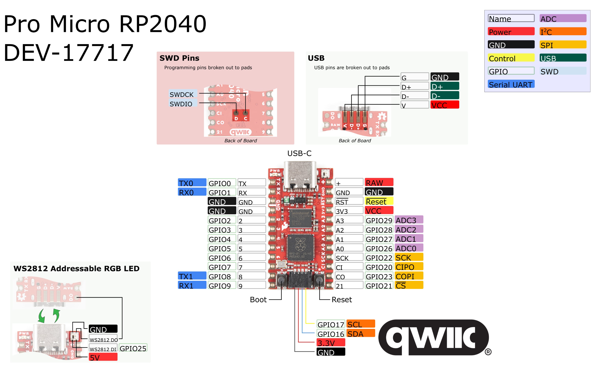
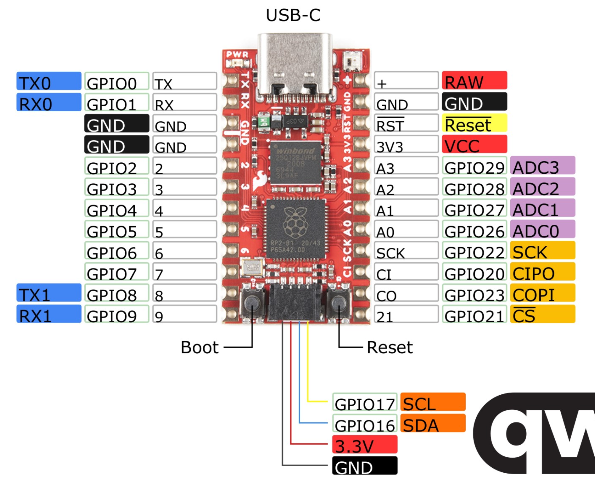
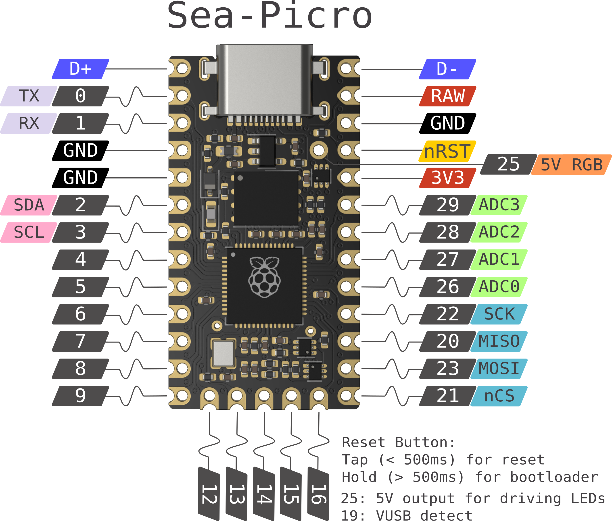
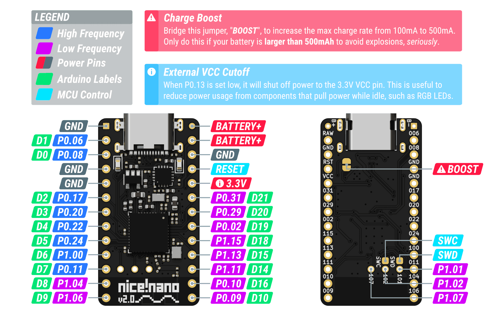

[library for KiCad](https://github.com/rroels/kicad_pro_micro_rp2040)  
[Ali 1](https://aliexpress.ru/item/1005006130019224.html)  
[Ali 2](https://aliexpress.ru/item/1005005881019149.html)  
[Manual - TENSTAR ROBOT RP2040 Pro Micro](https://manuals.plus/ae/1005006967374887)  

[Keyboard MCU list](https://github.com/bgkendall/keyboard_mcu_list)

